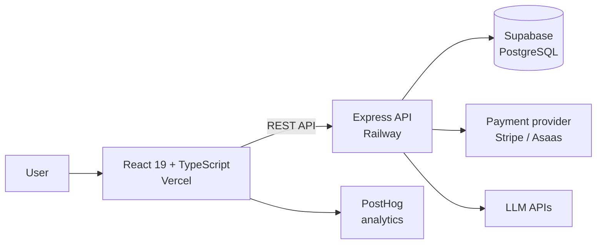

<h1>Bora na Tech</h1>

  <b>A Brazilian career platform for people getting into tech.</b> It helps users find the tech career that fits them, follow a learning roadmap, choose courses and get ready for the job market. Free to start, with a paid Pro plan.

&nbsp;

> **Note:** the source code is private. This repository is a public overview of the product and the engineering behind it. I'm happy to walk through the code in an interview.

## What it does

- **Career quiz** that points users to the tech areas that match their profile.
- **Learning roadmaps** with a step-by-step path for each area.
- **Curated course catalog**, free and paid, with filters.
- **Guides** on salaries, platforms and tech areas for people starting out, plus an English level test.
- **Pro plan** with AI-powered tools, such as resume, LinkedIn and GitHub review.

## My role

CTO and co-founder. I built the entire engineering side: architecture, database, back end, front end, deploy, CI/CD and AI integrations. My co-founder, the CEO, leads the business and content.

## Architecture

## Engineering highlights

- **TypeScript monorepo** with `client`, `server` and `shared` folders, so the front end and the API share code, plus versioned Supabase migrations.
- **Payment provider abstraction:** billing runs behind a `PaymentProvider` interface with Stripe and Asaas implementations, switched by an environment variable without touching the client.
- **Fail-closed billing switch:** subscriptions only open when a server-side flag is on. Otherwise the plans page shows a waitlist, and the API refuses checkout even if the UI is bypassed.
- **Split deploys:** React front end on Vercel and Express API on Railway, with public and secret environment variables kept on separate sides.
- **Strict quality gates:** no `any` in TypeScript, type checks before every commit and Conventional Commits.

## Tech stack

React 19 · TypeScript · Tailwind CSS v4 · Framer Motion · Express · Supabase (PostgreSQL) · Stripe · PostHog · Vercel · Railway

## Screenshots

  
  

## Status

Live since July 2026 at [boranatech.com.br](https://boranatech.com.br).
